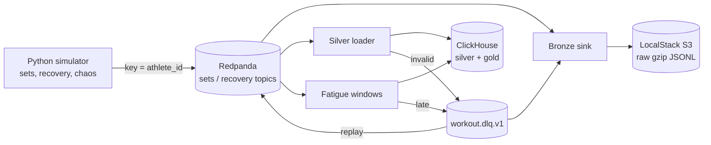

# Workout Telemetry Streaming Pipeline


Event-driven streaming pipeline for gym workout telemetry: contracts, at-least-once sinks, event-time windows and a replayable DLQ, fully local with Docker Compose.

## Architecture



A chaos-injecting simulator publishes keyed events to Redpanda, and three independent consumer groups fan out from it: a raw Bronze lake in S3, a validated and deduplicated Silver/Gold layer in ClickHouse, and event-time fatigue windows. Anything invalid or late is routed to `workout.dlq.v1` with its failure reason, archived to Bronze, and can be replayed back into the source topic with an attempt cap. Late events are routed to the DLQ for the streaming fatigue result, but they still pass validation and reach Silver, so the batch Gold views include them.

## What It Demonstrates

| Challenge | Implementation | Where |
|---|---|---|
| **Data Contracts** | JSON Schemas exported from strict Pydantic models and registered per subject with `BACKWARD` compatibility via `python -m telemetry.schemas.registry`. A removed field is caught by `make schemas-check` before registration; see the *Schema compatibility gate* bullet below for what it does not catch. Models use `extra="forbid"` and frozen instances, so unknown fields, wrong types, naive timestamps and negative reps are rejected. | [`schemas/`](schemas), [`events.py`](src/telemetry/schemas/events.py), [`registry.py`](src/telemetry/schemas/registry.py) |
| **At-Least-Once Raw Lake** | The Bronze sink batches records, writes gzip JSONL to S3 and commits offsets only after the write succeeds. A crash between write and commit causes redelivery, so Bronze guarantees **no gaps** (`missing=0`) and may contain duplicates. `make audit` checks every offset per partition. | [`bronze_sink/`](src/telemetry/consumers/bronze_sink), [`bronze_audit.py`](src/telemetry/tools/bronze_audit.py), [`01-create-buckets.sh`](infra/localstack/init/ready.d/01-create-buckets.sh) |
| **Idempotent Deduplication** | Silver tables are `ReplacingMergeTree`, deduplicating on `(athlete_id, event_time, event_id)` for sets and `(athlete_id, recovery_date)` for recovery. Merges are eventual, so queries use `FINAL` for read-time exactness. | [`silver_loader/`](src/telemetry/consumers/silver_loader), [`001_silver.sql`](infra/clickhouse/init/001_silver.sql), [`infra/clickhouse/init/`](infra/clickhouse/init) |
| **Event-Time Stream Processing** | Per-partition session windows (30 min gap) with a watermark and 10 min allowed lateness. Offsets are committed only up to the oldest offset still held by an open window. | [`fatigue_windows/`](src/telemetry/processing/fatigue_windows) |
| **Resilience & Failure Routing** | DLQ with structured reasons, an inspection tool and a replayer with an attempt cap. [`retry.py`](src/telemetry/retry.py) provides jittered exponential backoff for transient ClickHouse outages in the Silver loader. The producer relies on `enable.idempotence=true`, and S3 relies on boto3 standard retries. | [`dlq/`](src/telemetry/dlq), [`retry.py`](src/telemetry/retry.py), [`kafka_producer.py`](src/telemetry/producer/kafka_producer.py), [`clients.py`](src/telemetry/clients.py), [`create-topics.sh`](infra/redpanda/create-topics.sh) |

## Quickstart

**Prerequisites:** Docker Desktop (≥ 6 GB RAM), Python 3.12, `make`, and `git`.

```bash
cp .env.example .env   # then paste your LocalStack Pro token into LOCALSTACK_AUTH_TOKEN
make install           # creates .venv and installs the package with dev extras
make demo              # reset, start infra + apps, create topics, migrate, backfill
```

- **LocalStack:** the project is built and tested on LocalStack Pro (S3 persistence across restarts). `docker-compose.yml` defaults to `localstack/localstack-pro:4.4.0`. Reviewers without a Pro token can switch the image to `localstack/localstack:3.8` and remove `PERSISTENCE` and `LOCALSTACK_AUTH_TOKEN` from that service.
- **Data:** the backfill generates synthetic training data for 20 athletes × 42 days, with +1.5%/week progressive overload and sleep-coupled readiness, plus chaos events (2% malformed, 1% duplicate, 1% late).
- **Verify:** wait about 70 seconds so `fatigue-windows` flushes idle windows, then run `make audit` and `make dlq-inspect`.
- Redpanda Console: <http://localhost:8080>
- ClickHouse Play: <http://localhost:8123/play> (user `telemetry`, password `telemetry`)
- Follow the processors: `make apps-logs`
- Ad-hoc SQL: `make sql Q="SELECT ..."`

## Verified Guarantees

All output below was captured from real runs against the local stack.

### End-to-end reconciliation

| Stage | Count | Detail |
|---|---:|---|
| Simulated | 5,160 | 33 held back as late |
| Produced | 5,212 | + 52 duplicates (43 sets + 9 recovery) |
| DLQ | 107 | 76 malformed + 31 late past the watermark |
| Bronze unique offsets | 5,319 | 5,212 source records + 107 DLQ records, no gaps. The 437 duplicate lines from the crash drill are not counted |
| Unique Silver rows | 5,084 | 4,244 sets + 840 recovery |

**Late-event chain.** The backfill held back 33 sets as late, but the producer's chaos summary shows `'late': 32`. One held-back set was picked by the malformed dice roll first, so it was sent corrupted and counted as malformed instead. Of the 32 sets sent with the `late` label, 31 are in the DLQ past the watermark and 1 landed within the 10 min allowed lateness and joined its session.

**Duplicate arithmetic.** The set topic holds 4,363 messages (1094 + 873 + 217 + 873 + 870 + 436). 4,363 − 76 malformed − 43 duplicates = 4,244 unique Silver sets. Recovery is 849 messages − 9 duplicates = 840 rows.

### Bronze crash-recovery drill

The sink was stopped, its offsets and bucket were reset, and it was run with `--max-records 500 --crash-after-writes 3`. That run exited after its writes but before committing offsets. Then the container was restarted and left to drain.

```text
TOTAL missing=0 duplicated=437
```

`missing=0` means at-least-once held through the crash. `duplicated=437` is the redelivered batch (`workout.sets.v1[0]`), which is expected: Bronze trades duplicates for zero loss, and Silver deduplicates downstream.

<details>
<summary>Per-partition <code>make audit</code> output</summary>

```text
workout.sets.v1[0] offsets=1094 missing=0 duplicated=437
workout.sets.v1[1] offsets=873 missing=0 duplicated=0
workout.sets.v1[2] offsets=217 missing=0 duplicated=0
workout.sets.v1[3] offsets=873 missing=0 duplicated=0
workout.sets.v1[4] offsets=870 missing=0 duplicated=0
workout.sets.v1[5] offsets=436 missing=0 duplicated=0
recovery.daily.v1[0] offsets=384 missing=0 duplicated=0
recovery.daily.v1[1] offsets=339 missing=0 duplicated=0
recovery.daily.v1[2] offsets=126 missing=0 duplicated=0
workout.dlq.v1[0] offsets=44 missing=0 duplicated=0
workout.dlq.v1[1] offsets=53 missing=0 duplicated=0
workout.dlq.v1[2] offsets=10 missing=0 duplicated=0
TOTAL missing=0 duplicated=437
```

</details>

### DLQ breakdown (`make dlq-inspect`)

```text
== by consumer group and reason
fatigue-windows    late_event         31
silver-loader      validation_error   76
== by reason and chaos label
late_event         late               31
validation_error   missing_field      9
validation_error   naive_timestamp    11
validation_error   negative_reps      17
validation_error   truncated_json     15
validation_error   unknown_field      12
validation_error   wrong_type         12
== by attempts: {'1': 107}
== samples: validation_error
   workout.sets.v1[3]@30  workout.set_logged.reps: Input should be greater than or equal to 0
   workout.sets.v1[3]@99  workout.set_logged.mood: Extra inputs are not permitted
== samples: late_event
   workout.sets.v1[3]@870  event_time 2026-11-06T12:25:27+00:00 is older than watermark 2026-11-16T18:57:05+00:00 minus allowed lateness 0:10:00
   workout.sets.v1[3]@871  event_time 2026-11-06T12:47:58+00:00 is older than watermark 2026-11-16T18:57:05+00:00 minus allowed lateness 0:10:00
```

### Silver deduplication: raw vs `FINAL`

Before the drill the raw count was already 4,244 because the server setting `optimize_on_insert` is `1`, which collapses duplicate keys inside a single insert block, so duplicates that land in the same insert batch never became separate rows. Stopping merges and doing a second full pass is what makes duplicates visible.

Background merges were stopped on `silver_workout_sets`, the `silver-loader` group was rewound to the start, and every event was inserted a second time. The loader's DLQ was pointed at a scratch topic for this drill, so the real DLQ and Bronze numbers did not change.

```text
SYSTEM STOP MERGES telemetry.silver_workout_sets
-- rewind silver-loader to offset 0 and re-run: every event inserted again

SELECT count() AS raw_rows, uniqExact(event_id) AS unique_events FROM silver_workout_sets
   ┌─raw_rows─┬─unique_events─┐
1. │     8488 │          4244 │
   └──────────┴───────────────┘

SELECT count() FROM silver_workout_sets FINAL
   ┌─count()─┐
1. │    4244 │
   └─────────┘

SYSTEM START MERGES telemetry.silver_workout_sets
OPTIMIZE TABLE telemetry.silver_workout_sets FINAL

SELECT count() AS raw_rows, uniqExact(event_id) AS unique_events FROM silver_workout_sets
   ┌─raw_rows─┬─unique_events─┐
1. │     4244 │          4244 │
   └──────────┴───────────────┘

SELECT count() FROM silver_daily_recovery FINAL
   ┌─count()─┐
1. │     840 │
   └─────────┘
```

Raw rows exceed unique events while merges are stopped because `ReplacingMergeTree` only collapses duplicate keys when parts merge. `FINAL` deduplicates at read time, so it returns 4,244 whether or not a merge has run.

### Outage handling

Both drills rewound `silver-loader` and re-inserted existing events, so no counts changed (host-run loader, scratch DLQ topic).

**Short outage:** `docker compose stop clickhouse; sleep 5; docker compose start clickhouse` while the loader was running. It retried with backoff and finished the batch.

```text
23:10:31,143 WARNING telemetry.retry | insert into silver_workout_sets failed (attempt 1/6): Error HTTPConnectionPool(host='localhost', port=8123): Max retries exceeded ...
23:10:31,584 WARNING telemetry.retry | insert into silver_workout_sets failed (attempt 2/6): ...
23:10:32,478 WARNING telemetry.retry | insert into silver_workout_sets failed (attempt 4/6): ...
23:10:36,419 INFO    silver_loader | flushed 1212 messages, totals {'invalid': 76, 'sets': 4287, 'recovery': 849}
```

**Long outage:** ClickHouse stopped for about 30 s. The retries ran out, the loader process exited without committing the failing batch, and the group was left with lag.

```text
23:11:14,551 WARNING telemetry.retry | insert into silver_workout_sets failed (attempt 5/6): ...
23:11:14,679 ERROR   telemetry.retry | insert into silver_workout_sets failed after 6 attempts: ...
$ rpk group describe silver-loader      # after the process exited
STATE        Empty
TOTAL-LAG    1212
```

After ClickHouse was healthy again the loader restarted, re-read only the uncommitted batch and caught up:

```text
23:11:43,941 INFO    silver_loader | flushed 1212 messages, totals {'invalid': 19, 'sets': 1193, 'recovery': 0}
$ rpk group describe silver-loader
STATE        Stable
TOTAL-LAG    0
```

Outages are never sent to the DLQ, only bad data is. Infrastructure failures stop the consumer without committing, so nothing is lost.

## Gold Outputs

**`gold_acwr`:** acute:chronic workload ratio from session-RPE load (7-day acute vs 28-day chronic), with a risk zone.

```text
SELECT day, srpe_load, acute_7d, chronic_28d, acwr, risk_zone FROM gold_acwr WHERE athlete_id = 'ath_001' AND acwr IS NOT NULL ORDER BY day DESC LIMIT 3
   ┌────────day─┬─srpe_load─┬─acute_7d─┬─chronic_28d─┬─acwr─┬─risk_zone──┐
1. │ 2026-11-16 │     297.4 │    133.1 │       135.7 │ 0.98 │ sweet_spot │
2. │ 2026-11-15 │         0 │      136 │       136.8 │ 0.99 │ sweet_spot │
3. │ 2026-11-14 │         0 │      136 │       136.8 │ 0.99 │ sweet_spot │
   └────────────┴───────────┴──────────┴─────────────┴──────┴────────────┘
```

**`gold_personal_records`:** each set that beats the athlete's previous best estimated 1RM, with the improvement.

```text
SELECT exercise, weight_kg, reps, e1rm, previous_best, improvement_kg FROM gold_personal_records WHERE athlete_id = 'ath_001' ORDER BY event_time DESC LIMIT 3
   ┌─exercise────┬─weight_kg─┬─reps─┬──e1rm─┬─previous_best─┬─improvement_kg─┐
1. │ barbell_row │      72.5 │    5 │  84.6 │          81.7 │            2.9 │
2. │ bench_press │      82.5 │    5 │  96.2 │          93.3 │            2.9 │
3. │ deadlift    │       135 │    5 │ 157.5 │         154.6 │            2.9 │
   └─────────────┴───────────┴──────┴───────┴───────────────┴────────────────┘
```

The weekly progression is rounded to 2.5 kg plates, so each new PR is one plate heavier at the same reps; at 5 reps that raises the Epley e1RM by 2.5 × (1 + 5/30) ≈ 2.9 kg.

**`gold_session_fatigue`:** per-session event-time window metrics (volume, RPE drift, fatigue index) emitted by the streaming processor.

```text
SELECT athlete_id, window_start, set_count, round(volume_load_kg, 1) AS volume_kg, rpe_drift, fatigue_index, closed_by FROM gold_session_fatigue FINAL ORDER BY window_start DESC, athlete_id LIMIT 3
   ┌─athlete_id─┬────────────window_start─┬─set_count─┬─volume_kg─┬─rpe_drift─┬─fatigue_index─┬─closed_by─┐
1. │ ath_002    │ 2026-11-16 18:23:20.000 │        12 │      3815 │      0.83 │          13.9 │ idle      │
2. │ ath_016    │ 2026-11-16 18:17:20.000 │        11 │    3402.5 │      0.33 │          15.6 │ idle      │
3. │ ath_005    │ 2026-11-16 18:14:20.000 │        12 │      4607.5 │       0.5 │          16.7 │ idle      │
   └────────────┴─────────────────────────┴───────────┴───────────┴───────────┴───────────────┴───────────┘
```

**`gold_readiness`:** daily readiness score combining sleep, resting HR vs its 28-day baseline, and the previous day's ACWR, with a training recommendation.

```text
SELECT day, sleep_hours, resting_hr_bpm, rhr_baseline_28d, acwr_yesterday, readiness_score, recommendation FROM gold_readiness WHERE athlete_id = 'ath_001' ORDER BY day DESC LIMIT 3
   ┌────────day─┬─sleep_hours─┬─resting_hr_bpm─┬─rhr_baseline_28d─┬─acwr_yesterday─┬─readiness_score─┬─recommendation─┐
1. │ 2026-11-17 │           8 │             51 │             51.8 │           0.98 │              95 │ train_hard     │
2. │ 2026-11-16 │         7.4 │             54 │             51.8 │           0.99 │              85 │ train_hard     │
3. │ 2026-11-15 │         7.4 │             50 │             51.8 │           0.99 │              92 │ train_hard     │
   └────────────┴─────────────┴────────────────┴──────────────────┴────────────────┴─────────────────┴────────────────┘
```

## Testing & CI

```bash
make test               # unit tests: contracts, simulator, chaos corruptions, batcher and S3 keys, windows, retry
make test-integration   # end-to-end ingestion, dedup and DLQ against the running stack
make schemas-check      # compatibility check of the current contracts against the registry (no registration)
```

[`.github/workflows/ci.yml`](.github/workflows/ci.yml) runs ruff and the unit tests on every push to `main` and every pull request. The integration job runs only when `LOCALSTACK_AUTH_TOKEN` is configured in the repository secrets, and otherwise skips with a notice. When the secret is set, that job starts the stack, registers the schemas, runs `make schemas-check` as a smoke test, and then runs the integration tests.

## Design Decisions & Trade-Offs

- **Plain UTF-8 JSON vs. Avro/Protobuf.** JSON keeps every topic readable in Redpanda Console, `rpk` and `zcat`, and the JSON Schemas still give a real contract with strict validation. The cost is larger payloads and no schema ID in the wire format.
- **Schema compatibility gate.** `BACKWARD` is configured per subject. Originally the registry's checker answered `422 ... unsupported keyword: $ref` for any new version, because Pydantic emits `$ref`/`$defs` for the `Exercise` enum. `export_schema` now inlines those references (`inline_refs`, covered by a unit test). With that, a harmless optional field (`note: str | None = None`) is accepted as a new version, and removing a field is rejected with `409` (`PROPERTY_REMOVED_FROM_CLOSED_CONTENT_MODEL`; the checker's "closed content model" is the `additionalProperties: false` that the strict models emit). The checker does not flag every breaking change: adding a required field without a default (`tempo: str`) was accepted as a new version and `make schemas-check` reported it as compatible, so required-field additions still need review. `make schemas-check` runs the same compatibility check without registering anything and exits non-zero on an incompatible change. Run it locally against a registry that already holds the previous contracts; in CI the registry starts empty, so that step is only a smoke test that the check runs.
- **SQL views over `FINAL` vs. ClickHouse Materialized Views.** Most Gold layers are plain views over the Silver tables, so logic is easy to change, backfill and test, and nothing drifts from an insert-time trigger. The trade-off is query-time cost: Window functions and `FINAL` reads recompute on every read, which is fine at this scale but would need materialization or projections at much higher volume.
- **In-memory window state with `safe_commit_offset` vs. checkpointed state.** Window state lives in process memory, and the consumer commits only up to the oldest offset still needed by an open window. After a crash, Kafka replays the uncommitted events and rebuilds the windows without a state store. The cost is replay time and duplicate window emissions, which `ReplacingMergeTree` and `FINAL` absorb. Restart time grows with the number of open windows.
- **At-least-once + idempotent sinks vs. distributed transactions.** Each sink commits offsets after a durable write and tolerates redelivery: Bronze accepts duplicates (437 after the crash drill) in exchange for zero gaps, and Silver deduplicates with `ReplacingMergeTree`. That avoids cross-system two-phase commit, at the price of transient duplicates between a write and the next merge or `FINAL` read.

## What I'd Do Next

- **Real compatibility gate in CI.** Register the base branch's committed `schemas/*.json` in the CI registry, then run the compatibility check on the pull request's contracts, so a PR that removes a field fails. Also add a rule or test for required-field additions, which the registry's checker does not flag.
- **Avro/Protobuf wire format with schema IDs.** Move to a binary encoding with schema IDs in the wire format and registry-enforced compatibility modes (backward/full), so incompatible producers fail at publish time and payloads shrink.
- **Apache Flink with RocksDB state checkpoints.** Replace the hand-rolled windower with Flink's event-time windows, watermarks and exactly-once checkpoints, so restart no longer depends on replaying from the committed offset.
- **Prometheus/Grafana observability.** Export consumer lag, end-to-end latency, DLQ rate and watermark delay, with alerts on DLQ rate spikes per reason and on Bronze audit gaps.
- **Kubernetes with KEDA/HPA.** Deploy each processor as its own Deployment and autoscale on consumer-group lag, with partition count as the upper bound on replicas.
